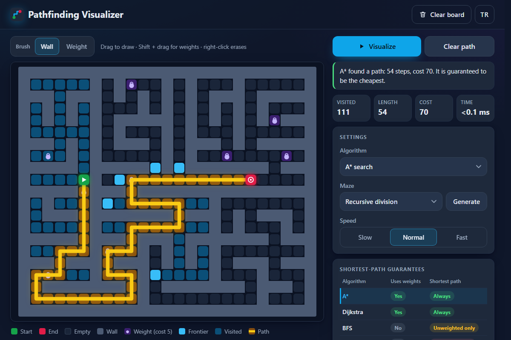

# Pathfinding Visualizer - watch A*, Dijkstra, BFS, greedy search and DFS find their way through a grid you draw

[](#tests) [](LICENSE)

**▶ Open the app: https://celaldrg.github.io/pathfinding-visualizer/**



## Features

- Five algorithms, animated step by step with their frontier and visited cells: A* (Manhattan heuristic), Dijkstra, breadth-first search, greedy best-first search and depth-first search.
- Draw walls and weights (a weight costs 5 to enter) with a mouse, pen or finger, and drag the start and end. Editing a finished run solves it again instantly, so the path follows your changes.
- Two maze generators, recursive division and randomized DFS. Both keep the start and end connected.
- Three speeds, skip to the end, clear the path or the whole board.
- Live stats: visited cells, path length, path cost and solve time.
- A guarantees table and a note after every run: A* and Dijkstra always return the cheapest path, BFS only on boards without weights, greedy search and DFS never promise it.
- English and Turkish. The app remembers your choice.
- Works on phones (touch, fewer columns), with the keyboard and with reduced motion, and stays sharp on high-DPI screens.
- No dependencies and no build step: plain HTML, CSS and ES modules.
- Add `?demo` to the address to open a finished A* run on a recursive-division maze.

## How to use

**Mouse**

- Click or drag on the grid to draw walls. A stroke that starts on a wall erases walls instead.
- Hold Shift while dragging, or switch the brush to **Weight**, to place weights.
- Drag with the right mouse button to erase.
- Drag the green start or the red end to move it.
- Pick an algorithm and press **Visualize**. Press it again to skip to the end.

**Touch**

- Draw with one finger. Use the Wall / Weight switch above the board for weights.
- Drag the green or red node to move it. Both have a larger grab area for fingers.
- The buttons and menus work as with a mouse.

**Keyboard**

| Key | Action |
| --- | --- |
| Space | Visualize, or skip to the end |
| C | Clear the path |
| Shift + C | Clear the board |
| M | Generate a maze |
| W | Switch between wall and weight |
| 1–5 | Choose an algorithm |
| Arrows + Enter | Move the grid cursor and paint (focus the board first; Shift + Enter places a weight) |
| S / E | Move the start or the end to the cursor |

## Run locally

ES modules do not load from `file://`, so serve the folder over `http://` with any static server, for example:

```sh
npx serve .
```

Then open the address it prints. There is nothing to install or build.

## Tests

```sh
node --test
```

The tests use `node:test` and `node:assert/strict`, need no dependencies and finish in a few seconds. They cover:

- the grid model, the binary heap and the seeded random number generator;
- all five algorithms: BFS, Dijkstra and A* match an independent reference solver on 200 seeded grids with and without weights, greedy search and DFS return a valid path exactly when one exists;
- both maze generators on 200 seeded mazes each: every open cell stays reachable and a seed always gives the same maze;
- the visualizer state machine: editing, dragging the endpoints, animation timing, resizing and the `?demo` state;
- the UI logic that runs without a browser: board sizing and hit testing, keyboard shortcuts, status and stats text in both languages, complete translations, storage that never throws, and static checks of the page (metadata, element ids, no external requests).

## Project structure

```text
index.html           page markup
style.css            dark theme and responsive layout
src/
  grid.js            grid model, costs and geometry
  heap.js            binary min-heap
  rng.js             seeded random numbers
  algorithms.js      the five searches as step generators
  mazes.js           maze generators
  game.js            visualizer state machine (no DOM)
  layout.js          board size, device pixels and hit testing
  shortcuts.js       keyboard mapping
  status.js          status line and stats text
  i18n.js            English and Turkish strings
  storage.js         safe localStorage wrapper
  renderer.js        canvas drawing
  pointer.js         mouse, pen and touch input
  panel.js           controls, stats and translations in the page
  main.js            entry point that wires everything together
test/                node:test suites
test-support/        shared test helpers: seeded grids, reference solver
docs/screenshot.png
```

## License

MIT, see [LICENSE](LICENSE).

## Türkçe

**▶ Uygulamayı aç: https://celaldrg.github.io/pathfinding-visualizer/**

Yol bulma görselleştiricisi: A*, Dijkstra, BFS, açgözlü arama ve DFS'nin senin çizdiğin bir ızgarada yolunu nasıl bulduğunu izle.

### Özellikler

- Beş algoritma, sınır ve gezilen hücreleriyle adım adım canlandırılır: A* (Manhattan sezgiseli), Dijkstra, genişlik öncelikli arama, açgözlü en iyi öncelikli arama ve derinlik öncelikli arama.
- Fare, kalem ya da parmakla duvar ve ağırlık çiz (ağırlıklı hücreye girmenin maliyeti 5), başlangıcı ve hedefi sürükle. Bitmiş bir aramada yaptığın her değişiklik yolu anında yeniden hesaplar; yol değişikliklerini izler.
- İki labirent üreteci: özyinelemeli bölme ve rastgele DFS. İkisi de başlangıç ile hedefi bağlı tutar.
- Üç hız, sona atlama, yolu ya da bütün tahtayı temizleme.
- Canlı istatistikler: gezilen hücre, yol uzunluğu, yol maliyeti ve çözüm süresi.
- Garanti tablosu ve her aramadan sonra bir not: A* ve Dijkstra her zaman en ucuz yolu bulur, BFS yalnız ağırlıksız tahtada, açgözlü arama ve DFS ise bunu hiç garanti etmez.
- İngilizce ve Türkçe. Uygulama seçimini hatırlar.
- Telefonda (dokunmatik, daha az sütun), klavyeyle ve azaltılmış hareket ayarıyla çalışır; yüksek DPI ekranlarda keskin kalır.
- Bağımlılık ve derleme adımı yok: düz HTML, CSS ve ES modülleri.
- Adrese `?demo` eklersen özyinelemeli bölme labirentinde bitmiş bir A* araması açılır.

### Nasıl kullanılır

**Fare**

- Duvar çizmek için ızgaraya tıkla ya da sürükle. Duvarın üstünde başlayan bir çizgi duvarları siler.
- Ağırlık koymak için Shift'e basılı tutarak sürükle ya da fırçayı **Ağırlık**'a çevir.
- Silmek için sağ fare tuşuyla sürükle.
- Yeşil başlangıcı ya da kırmızı hedefi sürükleyerek taşı.
- Bir algoritma seç ve **Görselleştir**'e bas. Yeniden basınca sona atlar.

**Dokunmatik**

- Tek parmakla çiz. Ağırlık için tahtanın üstündeki Duvar / Ağırlık anahtarını kullan.
- Yeşil ya da kırmızı düğümü sürükleyerek taşı. İkisinin de parmak için tutma alanı geniştir.
- Düğmeler ve menüler farede olduğu gibi çalışır.

**Klavye**

| Tuş | İşlev |
| --- | --- |
| Boşluk | Görselleştir ya da sona atla |
| C | Yolu temizle |
| Shift + C | Tahtayı temizle |
| M | Labirent oluştur |
| W | Duvar ile ağırlık arasında geçiş yap |
| 1–5 | Algoritma seç |
| Oklar + Enter | Izgara imlecini taşı ve boya (önce tahtaya odaklan; Shift + Enter ağırlık koyar) |
| S / E | Başlangıcı ya da hedefi imlece taşı |

### Yerelde çalıştırma

ES modülleri `file://` üzerinden yüklenmez; klasörü herhangi bir statik sunucuyla `http://` üzerinden sun, örneğin:

```sh
npx serve .
```

Sonra yazdırdığı adresi aç. Kurulacak ya da derlenecek bir şey yok.

### Testler

```sh
node --test
```

Testler `node:test` ve `node:assert/strict` kullanır, bağımlılık istemez ve birkaç saniyede biter. Kapsadıkları:

- ızgara modeli, ikili yığın ve tohumlu rastgele sayı üreteci;
- beş algoritmanın hepsi: BFS, Dijkstra ve A* ağırlıklı ve ağırlıksız 200 tohumlu ızgarada bağımsız bir referans çözücüyle aynı sonucu verir; açgözlü arama ve DFS yalnız yol varken geçerli bir yol döndürür;
- iki labirent üreteci de 200'er tohumlu labirentte: açık her hücreye ulaşılabilir ve aynı tohum hep aynı labirenti verir;
- görselleştiricinin durum makinesi: düzenleme, uç noktaları sürükleme, animasyon zamanlaması, yeniden boyutlandırma ve `?demo` durumu;
- tarayıcı olmadan çalışan arayüz mantığı: tahta boyutu ve isabet testi, klavye kısayolları, iki dilde durum ve istatistik metinleri, eksiksiz çeviriler, hiç hata fırlatmayan depolama ve sayfanın statik kontrolleri (meta veriler, öğe kimlikleri, dış istek olmaması).

### Proje yapısı

```text
index.html           sayfa iskeleti
style.css            koyu tema ve duyarlı yerleşim
src/
  grid.js            ızgara modeli, maliyetler ve geometri
  heap.js            ikili min-yığın
  rng.js             tohumlu rastgele sayılar
  algorithms.js      adım üreteci olarak beş arama
  mazes.js           labirent üreteçleri
  game.js            görselleştirici durum makinesi (DOM yok)
  layout.js          tahta boyutu, aygıt pikselleri ve isabet testi
  shortcuts.js       klavye eşlemesi
  status.js          durum satırı ve istatistik metinleri
  i18n.js            İngilizce ve Türkçe metinler
  storage.js         güvenli localStorage sarmalayıcısı
  renderer.js        tuval çizimi
  pointer.js         fare, kalem ve dokunmatik girdi
  panel.js           sayfadaki denetimler, istatistikler ve çeviriler
  main.js            her şeyi birbirine bağlayan giriş noktası
test/                node:test test dosyaları
test-support/        ortak test yardımcıları: tohumlu ızgaralar, referans çözücü
docs/screenshot.png
```

### Lisans

MIT, bkz. [LICENSE](LICENSE).
